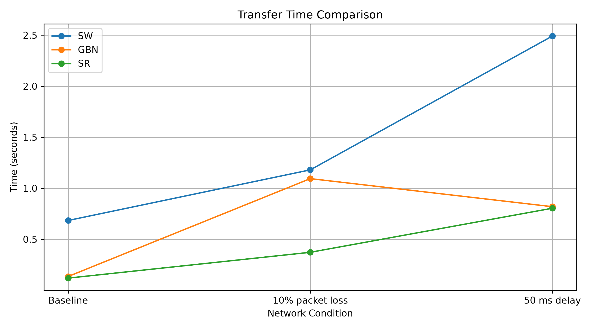
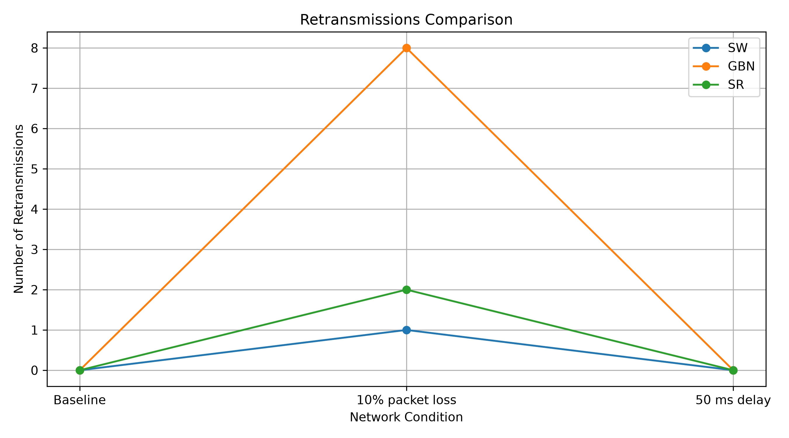
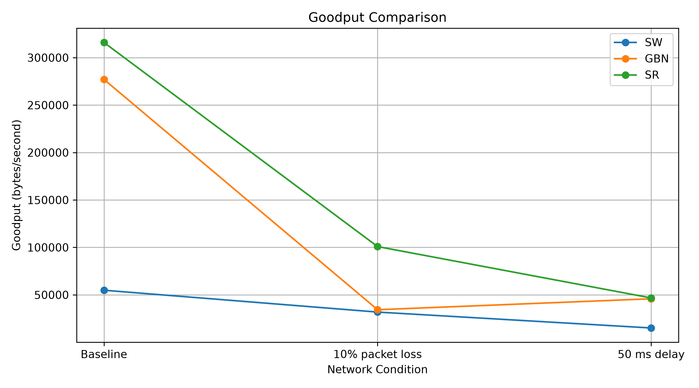

# Reliable Data Transfer over UDP

A Python-based implementation of reliable file transfer over UDP using three Automatic Repeat reQuest (ARQ) protocols: Stop-and-Wait, Go-Back-N and Selective Repeat.

## 1. Project Overview

UDP provides a connectionless method of data transmission but does not guarantee packet delivery, ordering or duplicate protection. This project implements reliability mechanisms on top of UDP to support accurate file transfer under different network conditions.

The project includes three ARQ protocols, a UDP channel emulator and an experimental framework for comparing their performance.

## 2. Project Objectives

- Implement Stop-and-Wait, Go-Back-N and Selective Repeat.
- Support packet sequencing and acknowledgement handling.
- Implement retransmission mechanisms to recover from packet loss.
- Simulate network conditions such as packet loss and delay.
- Transfer files and verify the received output.
- Compare protocol performance using transfer time, retransmission counts and goodput.

## 3. Technologies Used

- **Language:** Python
- **Networking:** UDP sockets
- **Libraries:** Python standard library, Matplotlib and Pytest
- **Data integrity:** SHA-256 hashing
- **Development environment:** Visual Studio Code

## 4. Project Structure

```text
coding-assignment1-p3/
|
|-- packet.py
|-- rto.py
|-- channel_emulator.py
|
|-- sw_sender.py
|-- gbn_sender.py
|-- arq_receiver.py
|
|-- sr_sender.py
|-- sr_receiver.py
|
|-- run_experiments.py
|-- make_graphs.py
|-- experiment_results.csv
|
|-- test_packet.py
|-- test_sr.py
|-- test_sr_receiver_manual.py
|-- test_sr_sender_delay.py
|-- test_sr_sender_loss.py
|-- test_udp_corruption.py
|-- test_udp_invalid.py
|
|-- sample.txt
|-- received_sw.txt
|-- received_gbn.txt
|-- received_sr.txt
|
|-- graphs/
    |-- transfer_time_comparison.png
    |-- retransmissions_comparison.png
    |-- goodput_comparison.png
```

## 5. Protocol Implementations

### Stop-and-Wait (SW)

The sender transmits one packet at a time and waits for its acknowledgement before sending the next packet. If an acknowledgement is not received within the timeout period, the packet is retransmitted.

### Go-Back-N (GBN)

The sender can transmit multiple packets within a predefined window. When a packet is lost, the sender retransmits the outstanding packets from the missing sequence number onward.

### Selective Repeat (SR)

The sender maintains a transmission window and retransmits only those packets for which acknowledgements have not been received. This avoids retransmitting packets that were successfully delivered.

## 6. UDP Channel Emulator

The channel emulator is used to introduce different network conditions during file transfer.

The emulator supports:

- Packet loss
- Packet corruption
- Packet duplication
- Packet reordering
- Network delay
- Jitter

This allows the protocols to be evaluated beyond normal network conditions.

## 7. Installation and Execution

### Install dependencies

```bash
py -m pip install pytest matplotlib
```

### Run the test suite

```bash
py -m pytest -v
```

### Run the experiments

```bash
py run_experiments.py
```

### Generate comparison graphs

```bash
py make_graphs.py
```

### Run individual protocols

Use separate terminals for the receiver and sender processes.

**Stop-and-Wait**

```bash
py arq_receiver.py --protocol SW
py sw_sender.py sample.txt
```

**Go-Back-N**

```bash
py arq_receiver.py --protocol GBN
py gbn_sender.py sample.txt
```

**Selective Repeat**

```bash
py sr_receiver.py
py sr_sender.py sample.txt
```

## 8. Experimental Evaluation

The three protocols were evaluated under three conditions:

1. Baseline
2. 10% packet loss
3. 50 ms network delay

All nine experiment runs completed successfully.

### Experimental Results

| Protocol | Condition | Transfer Time (s) | Retransmissions | Goodput (bytes/s) |
|---|---|---:|---:|---:|
| SW | Baseline | 0.684 | 0 | 54,862.29 |
| GBN | Baseline | 0.135 | 0 | 277,074.89 |
| SR | Baseline | 0.119 | 0 | 316,013.33 |
| SW | 10% packet loss | 1.180 | 1 | 31,820.89 |
| GBN | 10% packet loss | 1.094 | 8 | 34,314.02 |
| SR | 10% packet loss | 0.372 | 2 | 100,875.38 |
| SW | 50 ms delay | 2.492 | 0 | 15,062.57 |
| GBN | 50 ms delay | 0.819 | 0 | 45,833.03 |
| SR | 50 ms delay | 0.804 | 0 | 46,700.05 |

**Measurement note:** Transfer time is measured around the sender subprocess execution. Receiver and channel-emulator startup time is excluded. Goodput is calculated as the input file size in bytes divided by this measured sender execution time. These are application-level measurements, not a measurement of raw link capacity.

### Performance Graphs

**Transfer Time Comparison**



**Retransmissions Comparison**



**Goodput Comparison**



### Observations

- Under baseline conditions, SR recorded the lowest transfer time and highest goodput among the three protocols in this experiment.
- Under 10% packet loss, SR recorded the lowest transfer time and highest goodput. GBN recorded more retransmissions than SW and SR in this run.
- Under 50 ms delay, SR was marginally faster than GBN and recorded slightly higher goodput.
- SW was the slowest protocol under the tested delay condition.

These observations apply to the tested file, configuration and runs; they should not be treated as universal performance guarantees.

## 9. File Integrity Verification

The SHA-256 hashes of the original file and the files received through all three protocols were compared.

The following hash was obtained for each file:

```text
1489DB471C4B885498DE2EB6B161DD42CB2260CF31AEA7E716DC2E91AA5A4414
```

The matching hashes confirm that the received files were identical to the original file in the verified run.

## 10. Testing

The test suite was executed using:

```bash
py -m pytest -v
```

**Verified test result: 4 tests passed.**

The passing tests covered:

- RTO initial value
- RTO increase after timeout
- RTO maximum limit
- Packet encoding/decoding round-trip

## 11. Conclusion

This project demonstrates how reliability can be implemented over UDP using different ARQ protocols. The experimental results compare their behaviour under baseline conditions, packet loss and network delay.

The implementation also demonstrates the use of acknowledgements, retransmissions, timeout handling, channel emulation and file integrity verification.

## 12. Team Contributions

| Team Member | Roll Number | Contribution |
|---|---|---|
| Khushi Raj | 24155024 | Implemented and tested Stop-and-Wait and Go-Back-N protocols. |
| Ankita Priyadarshini | 2405933 | Worked on UDP communication, packet structure, sequence numbers and checksums. |
| Adyasha Pattnaik | 24158035 | Implemented Selective Repeat, acknowledgement handling and retransmission/RTO logic. |
| Rishiraj Mazumder | 241551017 | Worked on the channel emulator, experiments, data collection and performance graphs. |

All team members contributed to integration, testing, documentation and viva preparation.

## 13. Repository

**GitHub:** https://github.com/khushiraj-beep/coding-assignment1-p3